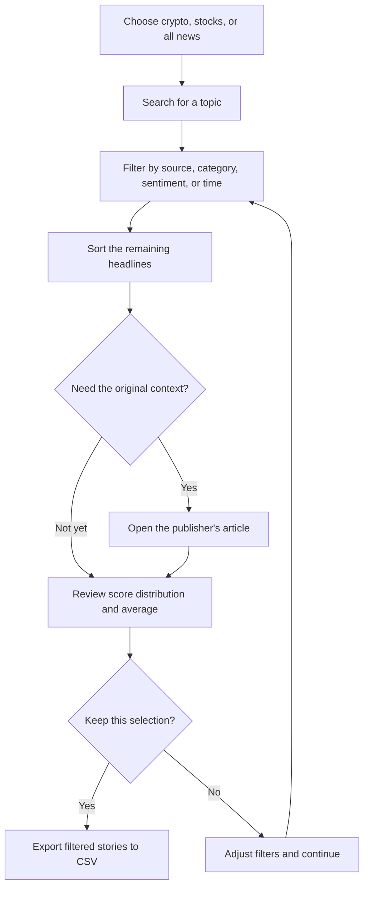
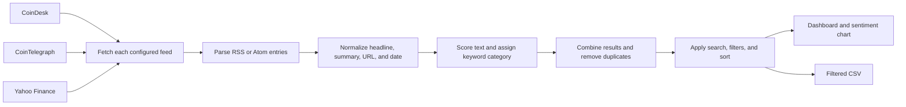
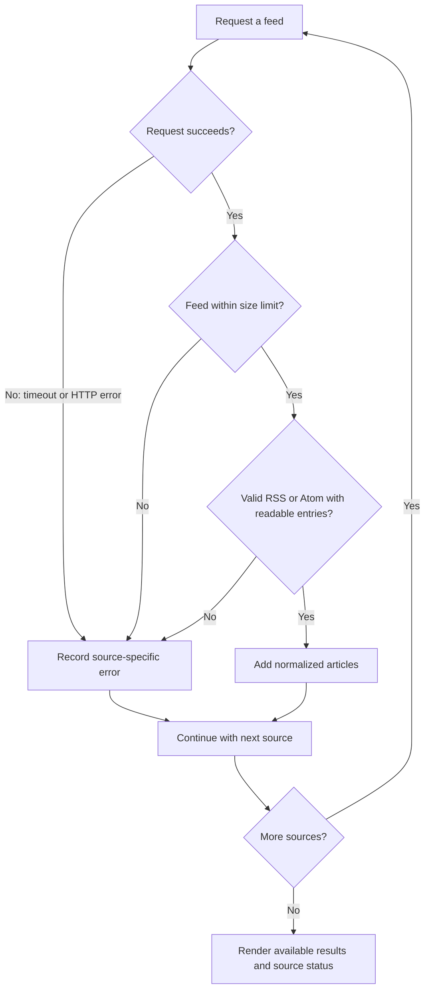

<div align="center">


### A multi-source market-news dashboard

Browse crypto and stock headlines, compare their language, and export the stories that match your research.

[](https://stocksnews.streamlit.app/)


</div>

> [!NOTE]
> News Pulse analyzes **headline wording**—not ~~price predictions~~ or investment recommendations.
> *Use the score to triage; verify the story at its source.*

## At a glance

| Capability | Details |
|:--|:--|
| Feed selection | Crypto, stocks, or all configured sources |
| Find stories | Search headlines, summaries, sources, and categories |
| Narrow results | Filter by category, source, sentiment, and publication window |
| Compare | Sort by newest, most positive, or most negative |
| Summarize | Article count, average score, overall tone, and sentiment chart |
| Export | Download the filtered results as CSV |
| Recover | Inspect per-feed status; manually refresh cached results |

### From question to reading list



<details>
<summary><strong>What does the sentiment score mean?</strong></summary>
<br>

VADER assigns a compound score between **−1.00** and **+1.00** to the headline and summary text.

| Compound score | Label |
|:--:|:--|
| `≤ -0.10` | Negative |
| `> -0.10` and `< 0.10` | Neutral |
| `≥ 0.10` | Positive |

The dashboard's average and overall tone use the articles left after filters are applied. VADER is a general-purpose, lexicon-based analyzer; it does not understand the complete article or financial context.

</details>

## How a headline becomes a result



| Stage | What happens |
|:--|:--|
| Fetch | Public feeds are requested with a timeout. Each feed is limited to 5 MB and up to 40 entries are processed. |
| Parse | RSS and Atom entries are normalized; HTML in summaries is reduced to readable text. |
| Validate | Only `http` and `https` article links are retained. |
| Enrich | Headline sentiment and a keyword-based category are added. |
| Present | Duplicate stories are removed, then the selected filters and sort order are applied. |

### A feed fails; the dashboard keeps going

Each configured provider is fetched separately. A failure is reported against that source; it does not prevent already-loaded stories from other providers from being displayed.



## Sources and refresh behavior

| Market | Source | Feed |
|:--|:--|:--|
| Crypto | CoinDesk | Public RSS |
| Crypto | CoinTelegraph | Public RSS |
| Stocks | Yahoo Finance | Public RSS |

Feed results are cached for **15 minutes**. **Refresh feeds now** clears that cache and retries the selected sources. If one provider is unavailable, the dashboard reports its error and can still show stories from other providers.

> **Operational note:** a successful app deployment does not guarantee every publisher's feed is reachable at all times. Check the **Feed status** panel when a source appears empty.

## Run locally

**Prerequisites:** Python 3.10 or later and internet access for the feeds. No API keys or database are required.

```powershell
python -m venv .venv
.\.venv\Scripts\Activate.ps1
python -m pip install -r requirements.txt
streamlit run news.py
```

Run the unit tests:

```powershell
python -m unittest discover -s tests -v
```

## Deploy on Streamlit Community Cloud

The repository is arranged for Community Cloud:

| Setting | Value |
|:--|:--|
| Entrypoint | `news.py` |
| Dependencies | `requirements.txt` |
| Streamlit theme | `.streamlit/config.toml` |
| Secrets / OS packages | Not required |

Connect the repository and branch in Streamlit Community Cloud, then select the root-level `news.py` entrypoint. See [DEPLOYMENT.md](./DEPLOYMENT.md) for deployment and troubleshooting details.

## Project map

```text
.
├── news.py                    # Streamlit interface and dashboard workflow
├── news_data.py               # Feed retrieval, parsing, dates, and classification
├── requirements.txt           # Runtime dependencies
├── .streamlit/config.toml      # Streamlit theme and server settings
├── tests/test_news_data.py     # Feed and date unit tests
├── .github/workflows/tests.yml # CI checks
└── DEPLOYMENT.md               # Community Cloud deployment guide
```

### Components

| Component | Role |
|:--|:--|
| [Streamlit](https://streamlit.io/) | Interface, controls, chart, and CSV download |
| [Requests](https://requests.readthedocs.io/) | HTTP feed retrieval |
| [ElementTree](https://docs.python.org/3/library/xml.etree.elementtree.html) | RSS / Atom XML parsing |
| [Beautiful Soup](https://www.crummy.com/software/BeautifulSoup/) | Cleaning HTML summaries |
| [VADER Sentiment](https://github.com/cjhutto/vaderSentiment) | Lexicon-based headline scoring |
| [python-dateutil](https://dateutil.readthedocs.io/) | Publication-date parsing |

GitHub Actions runs unit tests and syntax checks on Python 3.11, 3.12, and 3.13 for pushes and pull requests.

## Scope, limits, and interpretation

- **Sentiment is not prediction.** Headlines can be sarcastic, ambiguous, or financially nuanced; scores may miss that context.
- **Categories are keyword-based.** A story may be assigned to an imperfect category.
- **Feed coverage is external.** Publishers control their feed uptime and the stories they include.
- **Cached results are not instantaneous.** Articles may be up to 15 minutes old unless manually refreshed.
- **No trading signals.** The app does not fetch prices, forecast returns, or recommend investments.

> *“A score is a useful index into the text—not a substitute for reading the story.”*

<div align="center">

**Read. Filter. Verify at the source.**

[Open News Pulse ↗](https://stocksnews.streamlit.app/)

</div>
